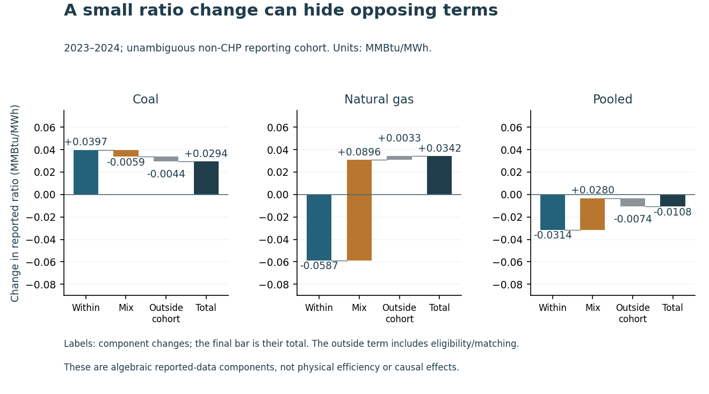

# Read reported heat-rate change before making efficiency claims

A fleet's fuel per unit of electricity can change because reported cell ratios change, generation moves between cells, or eligibility changes the matched cohort. This package separates those components before a fleet-level change is described as improved plant performance.

**Finding in the selected unambiguous pooled coal/gas cohort:** the 2023–2024 reported ratio moves from **8.608466 to 8.597667 MMBtu/MWh**. The small net change, **−0.010799**, contains a within-cell component of **−0.031403**, a mix component of **+0.028037**, and an outside-cohort composition remainder of **−0.007434**. Opposing terms matter; the headline ratio hides them. Independently rounded displays need not sum exactly.

Report the ratio, matching definition, components and finite plant-deletion sensitivity together. A physical-efficiency decision also needs consistent unit-level fuel/output allocation, technology and load evidence. **Within-cell change is not proof of engineering improvement; the remainder is not a physical entry/retirement measure.** No saving, deployment or causal benefit was measured.

Read the [six-page independent study](paper/manuscript.pdf), [complete held comparison](HELD_NOTE_V2.md), [development evidence](DEVELOPMENT_NOTE_V2.md), or [all 72 case sensitivities](figures/full_case_sensitivity.png). The manuscript is not peer reviewed. Full-size PNG/SVG figures and machine-readable values remain available beneath the concise first layer.

## The original source failure remains visible

The original study failed its unique source-key/plant-year CHP-consistency gate. In the 2018 workbook, plant 56668 / GT / NG appears with conflicting CHP/sector labels; non-overlap is unestablished. The [original protocol](PROTOCOL.md), [hold](SOURCE_HOLD.md) and [failed receipt](results/SOURCE_FAILURE.json) remain unchanged.

[Version 2](PROTOCOL_V2.md) fixes a separate, narrower cohort before decomposition. An identity-only pass quarantines an entire plant from every year if any year has conflicting state/CHP contexts or duplicate selected keys. It excludes **18 plants and 736 selected-fuel rows**, retains **27,842 unambiguous rows**, and never combines ambiguous quantities into a coverage total. It does not choose one conflicting row or invent a reporting partition. This is a source-quality-informed retrospective cohort, not blinded collection or external preregistration; v2 does not certify that v1 passed.

The denominator is this selected unambiguous reporting cohort, not the complete national fleet or a known national output share. Subsequent explicit non-CHP, state/DC, fuel, completeness and aggregate-positivity rules still apply. Every source quantity was present before analysis, and balanced-cohort membership uses all seven years.

## Run the offline bridge review

~~~sh
python -m pip install -r requirements.txt
python src/review_cli_v2.py
python src/review_cli_v2.py --end-year 2022 --fleet natural_gas
python src/replay_v2.py --out ../fresh-replay
~~~

The saved-result review checks the unrounded within + mix + outside-cohort bridge and flags opposing within/mix terms. It sends no source request and changes no plant or monitoring system. Three authored cases cover a valid opposing bridge, an inconsistent total that fails, and a missing component that stays unavailable. Passing this arithmetic check does not authenticate a new source or establish engineering performance.

Use a full-history clone and fresh external replay directory. Replay recomputes every fixed development/held case, per-cell contribution and primary plant deletion from selected public EIA facts. Exact complete private workbook checks remain separately hash-bound; offline replay does not reacquire mutable historical source vintages. Per-case measured runtimes remain separate from variable replay timings and are not production-speed benchmarks.

## Evidence and reproducibility

- Seven exact annual final historical EIA-923 archives for 2018–2024, captured 29 October 2026. Independent openpyxl identities/classifications and separate lxml raw-token parsing agree on the quarantine and every retained field. The native check reports 814,042 source/projected field conditions and 55,684 numeric conversion conditions; observed maximum conversion difference is 7e-10 under the fixed reader bound. This is software conversion evidence, not measurement accuracy.
- Exact source sums produce 29,996 group rows across two grains. Independent SQLite/80-digit Decimal grouping and membership checks pass 540,314 conditions. All 72 case memberships and 18 required primary supports pass; no secondary cohort is empty. The 329 negative-generation source components remain before aggregate positivity. Missing components are not imputed, and unassigned waste-heat output is not allocated to gas/coal.
- All 36 development and 36 held cases are estimable. Thirty-seven committed dependencies freeze before held outcomes. Complete exports retain both factor-order paths, symmetry, full/matched ratios and coverage, every outside-cohort bridge, 36,476 development/37,636 held per-case cell contributions, and 9,158 development/9,814 held whole-plant deletions. Repeated case contributions are not additional independent observations.
- Independent direct 80-digit paths and bridges, separately reconstructed plant-subtraction sums, and 27 fixed first/middle/last direct deletions per phase pass 658,242 development and 682,050 held conditions. The largest derived-value difference is about 3.64e-56 under the fixed 1e-45 bound. Twenty-two authored rational/eligibility fixture methods pass. Finite plant-deletion extrema are influence ranges, not confidence intervals.
- Separate full-history analysis clones at 25e290a pass on CPython 3.10.11/3.12.14: 615,290 exact and 818,646 derived numeric facts each, three public source files unchanged, no source request. Two as-run discrepancy fields are independently bounded. Raw tokens, source keys/counts and aggregated quantities are exact; derived rate/share comparisons use the declared numerical tolerance.
- Three inspected figures bind 297 source values/positions, 1,236 SVG coordinates, 156 numeric labels, 72 cell colors and nine hashes. The manuscript binds 43 values in 208 checks; all six current rendered pages were inspected. Specific figure checks and appearance do not establish universal correctness or accessibility conformance.

Exact candidate/main Linux success, matching tested/merged tree, annotated tag and scoped canonical publication checks belong to the selected revision: [PR 2](https://github.com/S3R3Bii/heat-rate-composition/pull/2), [Actions](https://github.com/S3R3Bii/heat-rate-composition/actions) and the [review receipt](REVIEW_RECEIPT.json). The [fixed implementation notes](METHODS_V2.md) explain exact source summation, numerical precision and the influence diagnostics.

## Source credit and interpretation

Source: U.S. Energy Information Administration, EIA-923 annual final historical 2018–2024 snapshots, captured 29 October 2026. [Dataset](https://www.eia.gov/electricity/data/eia923/), [definitions](https://www.eia.gov/survey/form/eia_923/instructions.pdf), [reuse guidance](https://www.eia.gov/about/copyrights_reuse.php). Selection, whole-plant quarantine, grouping and analysis are project transformations; no EIA endorsement is implied. MIT covers code; [source rights](DATA_RIGHTS.md) define the attributed factual-data subset.

The symmetric decomposition is an established algebraic identity. Annual reporting cells can change with load, internal technology composition, co-fuel allocation and reporting. The outside-cohort remainder includes eligibility/matching changes. The shared boundary year and seven-year balanced eligibility are retrospective, with no predictive generalization, engineering-efficiency, causal, physical entry/retirement or financial saving claim. No outlier is dropped after its influence is seen. Complete workbooks, agency artwork, excluded identifying/cost fields, credentials and formal-publication projects such as Azure optimization remain private.
